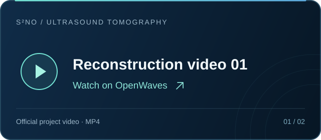
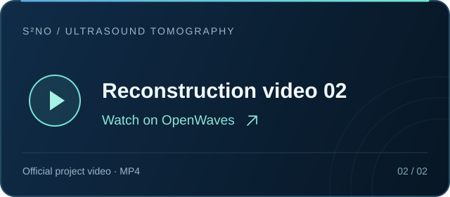

<p align="center">
  
</p>

<h1 align="center">S²NO · Ultrasound Tomography</h1>

<p align="center">
  <b>Ultrasound Tomography of Musculoskeletal Tissues<br>with Generative Neural Physics</b>
</p>

<p align="center">
  <a href="https://arxiv.org/abs/2508.12226"></a>
  <a href="https://ai4scientificimaging.org/OpenWaves/"></a>
  <a href="https://huggingface.co/OpenWaves"></a>
  <a href="LICENSE"></a>
</p>

<p align="center">
  Learning ultrasonic wave propagation for full-waveform inversion in strongly scattering tissues.
</p>

<p align="center">
  <a href="#showcase">Showcase</a> ·
  <a href="#installation">Installation</a> ·
  <a href="#training">Training</a> ·
  <a href="#forward-inference">Forward inference</a> ·
  <a href="#full-waveform-inversion">FWI</a> ·
  <a href="#citation">Citation</a>
</p>

## Showcase

<table>
  <tr>
    <td width="50%" align="center">
      <a href="https://ai4scientificimaging.org/OpenWaves/video/video1.mp4"></a>
    </td>
    <td width="50%" align="center">
      <a href="https://ai4scientificimaging.org/OpenWaves/video/video2.mp4"></a>
    </td>
  </tr>
</table>

<p align="center">
  <b>In vivo 3D ultrasound tomography of arms and legs</b><br>
  <a href="https://ai4scientificimaging.org/OpenWaves/video/video1.mp4">▶ Watch reconstruction video 1</a>
  &nbsp;·&nbsp;
  <a href="https://ai4scientificimaging.org/OpenWaves/video/video2.mp4">▶ Watch reconstruction video 2</a>
  &nbsp;·&nbsp;
  <a href="https://ai4scientificimaging.org/OpenWaves/#results">View all results</a>
</p>

Select either card to play the corresponding MP4 video hosted on the official project website.

## Overview

This is the official code repository for **S²NO**, the **Strong Scattering Neural Operator**, and its use in ultrasound computed tomography (USCT). S²NO learns a surrogate for acoustic wave propagation and supplies wavefields to a full-waveform inversion (FWI) procedure that reconstructs sound-speed maps.

This release organizes the original research code into three workflows:

| Workflow | Location | Included |
| --- | --- | --- |
| Train a wavefield surrogate | [`training/`](training/) | S²NO training code from `S2NO_main_clean`, model definitions, data loaders, and training configurations |
| Predict wavefields | [`inference/`](inference/) | Forward inference using a supplied checkpoint and input arrays |
| Reconstruct a phantom | [`fwi/`](fwi/) | The existing multi-frequency FWI algorithm, with CBS and S²NO solver options and a limb example |

**This is a source-code release.** Datasets, trained checkpoints, experimental measurements, generated reconstructions, and other large assets are external inputs. The FWI implementation is adapted from the original research implementation.

See the [release notes](docs/release.md) for source provenance, portability changes, and verification.

<p align="center">
  
</p>

## Repository layout

```text
S2NO_FWI_USCT/
├── training/               # Training, model definitions, and data loaders
│   └── configs/            # Supplied 500 kHz model configurations
├── inference/              # Forward wavefield prediction
├── fwi/                    # Original FWI algorithm and solver integrations
├── examples/
│   └── fwi/limb.yaml       # Sample limb reconstruction configuration
├── docs/
│   ├── training.md         # Data layout and training details
│   ├── inference.md        # Checkpoints and forward prediction
│   ├── fwi.md              # FWI assets, configuration, and algorithm details
│   └── assets/logo.svg     # Lightweight vector artwork
├── requirements.txt
├── CITATION.cff
└── citation.bib
```

## Installation

Use **Python 3.10 or 3.11**. Clone the repository and create a dedicated environment:

```bash
git clone https://github.com/yl602019618/S2NO_FWI_USCT.git
cd S2NO_FWI_USCT

python3.11 -m venv .venv
source .venv/bin/activate
python -m pip install --upgrade pip
```

Install a matching **PyTorch 2.5 or 2.6** build for your CUDA environment using the [official PyTorch installation instructions](https://pytorch.org/get-started/previous-versions/), then install the remaining requirements:

```bash
python -m pip install -r requirements.txt
```

Run the commands below from the repository root. The original training environment used PyTorch 2.6.0 with CUDA 11.8. Training and the full-resolution reconstruction workflows are intended for GPUs; see the workflow documentation for hardware and solver-specific requirements.

## Data and checkpoints

The [OpenWaves project page](https://ai4scientificimaging.org/OpenWaves/) describes the dataset and simulation workflow. Public data are available for [breast](https://huggingface.co/datasets/OpenWaves/Breast), [arm](https://huggingface.co/datasets/OpenWaves/arm), and [leg](https://huggingface.co/datasets/OpenWaves/leg) phantoms.

The Hugging Face repositories provide **500 kHz sample wavefields** and sound-speed data, along with instructions for generating additional wavefields. They are not a complete set of inputs for reproducing every experiment. In particular, multi-frequency FWI requires the matching observations, acquisition geometry, and other assets described in [the FWI guide](docs/fwi.md).

Keep data and checkpoints outside the source tree, and pass their locations to the command line. Training and S²NO inference must use compatible model configurations, preprocessing, homogeneous reference fields, and checkpoints. The sample FWI configuration also needs its external assets before reconstruction can run.

## Training

The training code comes from `S2NO_main_clean`. Start with the supplied 500 kHz S²NO configuration:

```bash
python -m training.main_pretrain \
  --config_file training/configs/s2no_500k_20_7_128.yaml \
  --data-root /path/to/OpenWaves \
  --no-experimental-validation
```

Set the data paths, sample counts, batch size, and GPU count for your dataset and hardware. The provided configuration retains the research model settings; a smaller dataset requires corresponding changes to its sample counts. Experimental validation is optional and requires separate experimental assets.

See [the training guide](docs/training.md) for the required array layout, preprocessing, configuration fields, and checkpoint handling.

## Forward inference

Predict a wavefield from a sound-speed map and its matching homogeneous reference field:

```bash
python -m inference.predict \
  --checkpoint /path/to/checkpoint.ckpt \
  --speed /path/to/speed.npy \
  --homogeneous /path/to/homogeneous.npy \
  --batch-size 8 \
  --output outputs/predicted_wavefield.npy
```

The speed input is a real `(480, 480)` NumPy array in m/s; the homogeneous input is a complex `(sources, 480, 480)` array in the training field units. The output is a complex NumPy array with the same source and spatial dimensions. Supply a checkpoint and inputs that match the model's frequency, source arrangement, and normalization.

CUDA is the default device. Use `--device cpu` when needed, and match `--padding` (default: `6`) and `--add-term` to the training configuration. Checkpoints are not bundled with this repository. Consult [the inference guide](docs/inference.md) and the command's `--help` output for checkpoint formats, model options, and preprocessing details.

## Full-waveform inversion

The limb example exposes the original reconstruction workflow through a configuration file. It includes the full FWI algorithm and supports a conventional **convergent Born series (CBS)** solver or the learned **S²NO** solver.

First, prepare the external assets and review [`examples/fwi/limb.yaml`](examples/fwi/limb.yaml), following [the FWI guide](docs/fwi.md). Then run a CBS reconstruction:

```bash
python -m fwi.run \
  --config examples/fwi/limb.yaml \
  --solver cbs \
  --data-root /path/to/fwi_assets \
  --output outputs/limb_cbs
```

To use S²NO, supply the compatible trained checkpoints for the frequencies in the reconstruction schedule:

```bash
python -m fwi.run \
  --config examples/fwi/limb.yaml \
  --solver s2no \
  --data-root /path/to/fwi_assets \
  --checkpoint-root /path/to/checkpoints \
  --output outputs/limb_s2no
```

The CBS path does not require neural-network checkpoints. Both paths require the FWI assets; the sample configuration is an entry point to the algorithm, not a bundled reconstruction dataset. See [the FWI guide](docs/fwi.md) for the frequency schedule, solver setup, required files, and output format.

## Citation

If you use this code in your research, please cite the [paper](https://arxiv.org/abs/2508.12226). The citation below follows the current arXiv record; it is also available in [`citation.bib`](citation.bib) and [`CITATION.cff`](CITATION.cff).

```bibtex
@misc{zeng2026ultrasoundtomographymusculoskeletaltissues,
  title={Ultrasound Tomography of Musculoskeletal Tissues with Generative Neural Physics},
  author={Zhijun Zeng and Youjia Zheng and Chang Su and Qianhang Wu and Hao Hu and Zeyuan Dong and Yang Lv and Ligang Cui and Zhiyong Hou and Weijun Lin and Zuoqiang Shi and Yubing Li and He Sun},
  year={2026},
  eprint={2508.12226},
  archivePrefix={arXiv},
  primaryClass={cs.CV},
  url={https://arxiv.org/abs/2508.12226}
}
```
